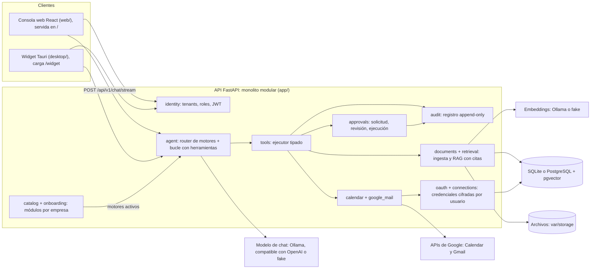

# admin-agent

Asistente de trabajo con IA para empresas: cada organización (tenant) tiene su propio agente,
que responde a partir de los documentos de la empresa con citas verificables y opera, con
permiso, las herramientas de cada persona (Google Calendar, Gmail). Está pensado para pymes
que quieren automatizar tareas administrativas sin perder privacidad, control de permisos ni
trazabilidad: la inferencia es local con Ollama por defecto, cada acción sensible se aprueba
en el chat y todo queda auditado.

**Accesos rápidos:** [Cómo instalar](#cómo-instalar) · [Arquitectura](#arquitectura) ·
[Cómo contribuir](#cómo-contribuir-flujo-de-pr) · [Guía de desarrollo](docs/dev-setup.md)

## La idea

Un asistente personal para el día a día de cada empleado, que conoce la empresa y que la
propia empresa configura desde una consola web.

| Pieza | Qué aporta |
| --- | --- |
| Base de conocimiento | El agente responde con los documentos de la organización (RAG) y cita el fragmento exacto que usa |
| Módulos activables | El administrador activa por empresa los módulos disponibles (hoy, Google Calendar y Gmail); cada persona conecta su propia cuenta con un asistente guiado |
| Aprobación humana | Cada herramienta declara su rol mínimo y su política de aprobación; las que la exigen muestran en el chat **Aprobar y ejecutar** / **Rechazar** antes de hacer nada. El modelo nunca autoriza |
| Auditoría | Registro append-only de acciones, resultados y aprobaciones, correlacionado por ejecución |
| Superficies | Consola web (Chat, Base de conocimiento, Configuración) y widget de escritorio, siempre a mano |

Política de aprobación actual: las acciones de Gmail (enviar, archivar, etiquetar) siempre
piden aprobación y solo puede decidirlas quien las pidió; crear y cancelar eventos en el
propio calendario se ejecutan sin aprobación (decisión del MVP: es la agenda del propio
usuario).

| Rol | Puede |
| --- | --- |
| Propietario (`owner`) | Todo, incluida la gestión de propietarios y la consulta de la auditoría |
| Administrador (`admin`) | Gestionar el equipo (salvo propietarios) y activar módulos |
| Operador (`operator`) | Chatear, subir documentos y ejecutar acciones de herramientas |
| Lector (`viewer`) | Chatear, buscar y consultar documentos (solo lectura) |

> **Privacidad.** Con un proveedor de chat externo (`AA_LLM_PROVIDER=openai_compatible`), los
> mensajes y los fragmentos de documentos salen de la máquina. Úsalo solo con los datos
> sintéticos de `make demo`; los embeddings siempre son locales.

## Arquitectura

Un monolito modular en FastAPI (`app/`) sirve la API (`/api/v1/...`), la consola web ya
compilada en `/` y la ruta `/widget` que carga el widget de escritorio. Cada dominio es un
módulo en `app/modules/*`; los módulos de negocio se registran en un catálogo y se activan por
empresa sin tocar el núcleo.



### Qué ocurre con un mensaje de chat

1. La consola web o el widget envía el mensaje a `POST /api/v1/chat/stream` (SSE).
2. El router de motores elige un motor: `knowledge` (búsqueda en documentos) o el de un módulo
   activo. Es una llamada corta al modelo y se omite cuando solo hay un motor.
3. El bucle del agente llama al modelo con las herramientas de ese motor, como máximo
   `AA_AGENT_MAX_STEPS` veces.
4. El ejecutor de herramientas busca la herramienta, comprueba el rol, valida la entrada y
   aplica la política de aprobación antes de ejecutarla.
5. Si hace falta aprobación, se crea una solicitud ligada a la acción y su payload exactos; el
   chat la muestra y no se ejecuta nada hasta que se aprueba.
6. Todo lo anterior queda en la auditoría.

### Módulos del backend

| Módulo (`app/modules/`) | Responsabilidad |
| --- | --- |
| `identity` | Usuarios, empresas (tenants), roles, login JWT y sesiones persistentes |
| `documents` | Subida, validación, extracción de texto y troceado |
| `retrieval` | Embeddings y búsqueda semántica, por palabras o híbrida, con citas |
| `agent` | API de chat (JSON y SSE), router de motores y bucle con herramientas |
| `tools` | Registro tipado de herramientas (rol mínimo, política de aprobación) y ejecutor |
| `approvals` | Flujo solicitud → revisión → ejecución con autorizaciones de un solo uso |
| `audit` | Registro append-only de acciones, resultados y aprobaciones |
| `catalog` | Manifiestos de módulos y activación por empresa |
| `onboarding` | Pasos guiados para conectar un módulo |
| `oauth` | Flujo authorization code + PKCE con Google |
| `connections` | Credenciales por usuario cifradas con Fernet (`AA_CREDENTIALS_KEY`) |
| `calendar` | Google Calendar: listar, crear y cancelar eventos |
| `google_mail` | Gmail: buscar, leer, enviar, archivar y etiquetar |
| `widget` | Publicación de los instaladores del widget (`/api/v1/widget/installers`) |

### Carpeta → responsabilidad

| Carpeta | Responsabilidad |
| --- | --- |
| `app/main.py` | Fábrica de la aplicación: routers, registro de módulos, web en `/` y consola `/ui` |
| `app/core/` | Configuración `AA_*`, base de datos, cifrado y logging |
| `app/modules/` | Un paquete por dominio (tabla anterior) |
| `app/demo/` | Seed de la empresa ficticia y cliente de chat por consola |
| `app/ui/static/` | Consola de desarrollo en HTML + JS (`/ui`, solo en entornos de desarrollo) |
| `packages/contracts/` | Contratos Pydantic compartidos entre módulos |
| `web/` | Consola web: React + Vite + TypeScript, interfaz en español |
| `desktop/` | Widget de escritorio: Tauri 2 (Rust) |
| `tests/` | Suite de pytest del backend |
| `deployment/` | Docker Compose y perfiles de desarrollo (`deployment/dev/`) |
| `docs/` | Guías de desarrollo, Gmail y widget |

**Proveedores.** Chat: `ollama` (predeterminado), `openai_compatible` (por ejemplo xAI Grok) o
`fake` (tests). Embeddings: `ollama` (`nomic-embed-text`, 768 dimensiones) o `fake`. Base de
datos: SQLite (`aiosqlite`) o PostgreSQL con pgvector. Los archivos se guardan en disco
(`AA_STORAGE_BASE_DIR`).

**CI** (`.github/workflows/ci.yml`, en cada pull request y en cada push a `main`):

| Job | Pasos |
| --- | --- |
| `backend` (Python 3.12) | `ruff check .`, `ruff format --check .`, `pytest` |
| `web` (Node 22) | `npm run typecheck`, `npm run lint`, `npm test -- --run` (Vitest) |

## Cómo instalar

### Requisitos

| Herramienta | Versión | Para qué |
| --- | --- | --- |
| Python | 3.12 o superior | Backend (`pyproject.toml`) |
| Node.js + npm | 22.22 o superior | Consola web (`web/package.json`) |
| Ollama o una clave de xAI | — | Modelo de chat, según el perfil elegido |
| Rust (rustup) y librerías de Tauri | — | Solo para el widget ([ver requisitos](docs/desktop-widget.md#prerrequisitos)) |

### Ruta rápida

Ejecuta todo desde la raíz del repositorio.

1. Instala el backend. El `Makefile` usa `.venv` automáticamente, sin activarlo:

   ```bash
   python3 -m venv .venv && make install
   ```

2. Elige un perfil y cópialo a `.env` (está en `.gitignore`):

   ```bash
   cp deployment/dev/ollama.env.example .env   # o deployment/dev/grok.env.example
   ```

   | Perfil | Uso | Necesita |
   | --- | --- | --- |
   | `ollama.env.example` | Predeterminado del producto: chat y embeddings locales; nada sale de la máquina | `ollama pull qwen2.5:7b-instruct && ollama pull nomic-embed-text` (varios GB de RAM) |
   | `grok.env.example` | Equipo modesto: chat con xAI Grok y embeddings `fake` | `AA_LLM_API_KEY` de xAI; solo datos sintéticos |

   Ambos usan SQLite (`dev.db`). Para PostgreSQL, consulta
   [SQLite o Postgres](docs/dev-setup.md#sqlite-or-postgres).

3. Revisa `.env`. Los ajustes se leen de variables con prefijo `AA_` (`app/core/config.py`):

   | Variable | Obligatoria | Notas |
   | --- | --- | --- |
   | `AA_DATABASE_URL` | Sí | `sqlite+aiosqlite:///./dev.db` en los perfiles |
   | `AA_JWT_SECRET` | Sí | `python3 -c "import secrets; print(secrets.token_urlsafe(32))"` |
   | `AA_LLM_PROVIDER`, `AA_LLM_MODEL` | Sí | `ollama`, `openai_compatible` o `fake` |
   | `AA_LLM_BASE_URL`, `AA_LLM_API_KEY`, `AA_ALLOW_EXTERNAL_LLM=true` | Solo con `openai_compatible` | La API no arranca sin las tres |
   | `AA_EMBEDDING_PROVIDER`, `AA_EMBEDDING_MODEL`, `AA_EMBEDDING_DIM` | Sí | Si los cambias tras el seed, borra `dev.db` y `var/storage` y repite `make demo` |
   | `AA_CREDENTIALS_KEY` | Para Calendar y Gmail (y siempre en producción) | Clave Fernet; ver el comando siguiente |
   | `AA_GOOGLE_CLIENT_ID`, `AA_GOOGLE_CLIENT_SECRET` | Para Calendar y Gmail | Ver [Google Cloud](#opcional-google-calendar-y-gmail) |

   ```bash
   .venv/bin/python -c "from cryptography.fernet import Fernet; print(Fernet.generate_key().decode())"
   ```

4. Crea la empresa de demostración (esquema, equipo y 29 documentos ficticios):

   ```bash
   make demo
   ```

   Inicia sesión con la empresa `demo` y, por ejemplo, `admin@demo.test` / `demo-admin-pass`.
   Hay un usuario por rol con el patrón `<rol>@demo.test` / `demo-<rol>-pass`.

5. Compila la consola web y arranca la API:

   ```bash
   make app    # http://localhost:8000/
   curl localhost:8000/healthz
   ```

### Desarrollo diario

| Comando | Qué hace |
| --- | --- |
| `make dev` | API con recarga en <http://localhost:8000> (lee `.env`) |
| `make web-dev` | Vite con recarga en <http://localhost:5173>; reenvía `/api` a `make dev` |
| `make chat` / `make chat user=viewer` | Cliente de chat por consola |
| `make lint` / `make format` | Comprueba o corrige el estilo con Ruff |
| `make test` | Suite de pytest |
| `make web-test` | Typecheck, lint y Vitest de la consola web |

Con `make dev` en marcha, <http://localhost:8000/ui/> ofrece además una consola de desarrollo
mínima. Para reiniciar los datos: `rm -f dev.db && rm -rf var/storage && make demo`.

Alternativa con contenedores: `docker compose -f deployment/docker-compose.yml up --build`
levanta la API en el puerto 8000 con PostgreSQL, Redis, MinIO y Ollama (lee `.env.example`).

### Opcional: Google Calendar y Gmail

1. En un proyecto de Google Cloud, habilita **Google Calendar API** y **Gmail API**.
2. Configura la pantalla de consentimiento (tipo Externo, estado Prueba) y añade como usuarios
   de prueba las cuentas que vayan a conectarse.
3. Crea un cliente OAuth de tipo **Aplicación web** con esta URI de redirección autorizada:

   ```text
   http://localhost:8000/api/v1/oauth/google/callback
   ```

4. Define `AA_GOOGLE_CLIENT_ID`, `AA_GOOGLE_CLIENT_SECRET` y `AA_CREDENTIALS_KEY` en `.env`
   y reinicia con `make app`.
5. Abre la aplicación en `http://localhost:8000`, no en `http://127.0.0.1:8000`: Google exige
   que la URI coincida exactamente y ambos orígenes no son intercambiables.
6. Como administrador: **Configuración → Herramientas** → activar el módulo. Cada persona lo
   conecta en **Configuración → Mis herramientas**.

Detalles de permisos, alcance del buzón y protocolo de prueba: [docs/google-mail.md](docs/google-mail.md).

### Opcional: widget de escritorio

| Comando | Qué hace |
| --- | --- |
| `make widget-dev` | Abre el widget contra el servidor configurado (`AA_SERVER_URL`, después `config.toml` y, por defecto, `http://127.0.0.1:8000`) |
| `make widget-package` | Genera el `.deb` y el AppImage en `desktop/src-tauri/target/release/bundle/` |
| `make widget-publish` | Empaqueta y copia los instaladores a `var/widget-installers/`, que sirve la API |

Instalación, atajos de teclado y solución de problemas: [docs/desktop-widget.md](docs/desktop-widget.md).

## Cómo contribuir: flujo de PR

Una petición = una rama = un PR pequeño y verificable. El ciclo completo:

1. **Rama desde `main` actualizado**, con el formato `<tipo>/<descripcion-corta>`:

   ```bash
   git switch main && git pull --ff-only
   git switch -c feat/descripcion-corta
   ```

   Tipos: `feat` (funcionalidad), `fix` (corrección), `docs`, `ci`, `chore` (mantenimiento),
   `refactor` (sin cambio de comportamiento) y `test`.

2. **Commits** con [Conventional Commits](https://www.conventionalcommits.org/) en inglés, por
   ejemplo `feat(mail): add label tool`. Cada commit es una unidad revisable que incluye sus
   pruebas y su documentación. Sin líneas de atribución a herramientas de IA.
3. **Comprobaciones locales** antes de subir:

   ```bash
   make lint        # ruff check . && ruff format --check .
   make test        # pytest
   make web-test    # solo si cambia web/
   ```

4. **Tamaño**: como máximo unas 400 líneas cambiadas (añadidas + eliminadas) por PR. Si el
   trabajo es mayor, divídelo en PR apilados: el primero contra `main` y cada siguiente contra
   la rama del anterior. Solo si no se puede dividir, añade la etiqueta `size:exception` y
   explica el motivo en la descripción.
5. **Abrir el PR**:

   ```bash
   git push -u origin feat/descripcion-corta
   gh pr create --base main --title "feat(mail): add label tool" --body-file pr.md
   ```

   Plantilla para `pr.md`:

   ```markdown
   ## Summary
   <What changes and why, in one to three sentences.>

   ## Key changes
   - <change>

   ## Verification
   - `make lint`: <result>
   - `make test`: <result>
   - `make web-test`: <result, only if web/ changed>

   ## Known limitations
   - <limitation, or "None">

   ## Chain context
   <Stacked PRs only: previous PR, next PR, and what to review here.>
   ```

6. **CI en verde y revisión.** GitHub no permite que el autor apruebe su propio PR; con un solo
   mantenedor, el PR se revisa y se fusiona sin aprobación formal.
7. **Fusionar** según el tipo de PR, comprobando siempre la base antes
   (`gh pr view <N> --json baseRefName`):

   | PR | Estrategia |
   | --- | --- |
   | Independiente | Squash (`gh pr merge <N> --squash`) |
   | Base de una pila | Merge commit (`gh pr merge <N> --merge`); un squash ensuciaría el diff del PR hijo |
   | Hijo, ya con base `main` | Squash si es el último de la pila; merge commit si tiene hijos ([orden obligatorio](#orden-obligatorio-al-fusionar-pr-apilados)) |

8. **Limpieza**: borra la rama y actualiza `main` local:

   ```bash
   git push origin --delete feat/descripcion-corta
   git switch main && git pull --ff-only && git branch -d feat/descripcion-corta
   ```

### Orden obligatorio al fusionar PR apilados

GitHub fusiona un PR en su base actual, así que un hijo fusionado antes de cambiar su base
aterriza en la rama del padre y no en `main`; la base de un PR cerrado ya no se puede cambiar
y la única recuperación es abrir un PR nuevo desde esa rama hacia `main`.

1. Fusiona el PR padre en `main` con merge commit.
2. **Antes** de fusionar el hijo, cambia su base a `main` y comprueba que su diff solo muestra
   sus propios archivos:

   ```bash
   gh api -X PATCH repos/IvalDev/agentop/pulls/<N> -f base=main
   gh pr view <N> --json baseRefName
   gh pr diff <N> --name-only
   ```

   Usa `gh api`: `gh pr edit --base` falla hoy por la API obsoleta de Projects (classic).
3. Solo entonces fusiona el hijo.

No borres la rama del padre hasta haber cambiado la base del hijo.

### Checklist del PR

- [ ] Rama `<tipo>/<descripcion-corta>` creada desde `main` actualizado
- [ ] Commits con Conventional Commits en inglés, con pruebas y documentación, sin atribución a IA
- [ ] `make lint` y `make test` en verde (y `make web-test` si cambia `web/`)
- [ ] Unas 400 líneas cambiadas como máximo, o PR apilados, o `size:exception` justificada
- [ ] Descripción con Summary, Key changes, Verification, Known limitations (y Chain context si está apilado)
- [ ] CI en verde
- [ ] Base comprobada antes de fusionar; en una pila, hijo con base `main` antes de fusionarlo
- [ ] Rama borrada y `main` local actualizado

## Estado del proyecto

| Área | Estado |
| --- | --- |
| Núcleo: identidad, documentos y RAG, chat, herramientas, aprobaciones, auditoría | Disponible |
| Consola web y módulos Google Calendar y Gmail | Disponible |
| Widget de escritorio | Linux (`.deb` y AppImage); Windows y macOS pendientes |
| Espacio de trabajo del agente: carpeta del servidor con la documentación de la empresa (`RAG/`) separada de una carpeta por empleado, que es el alcance de su agente | Diseñado, sin implementar |
| Almacenamiento en MinIO y cola Redis + RQ | Previstos; hoy los archivos van a disco y la ingesta es síncrona |
| Migraciones de Alembic | Configuradas, sin revisiones; `make demo` crea el esquema en desarrollo |

**Documentación:** [docs/dev-setup.md](docs/dev-setup.md) (entorno ligero, equipo de demo, API
de equipo, RAG paso a paso) · [docs/google-mail.md](docs/google-mail.md) ·
[docs/desktop-widget.md](docs/desktop-widget.md)
